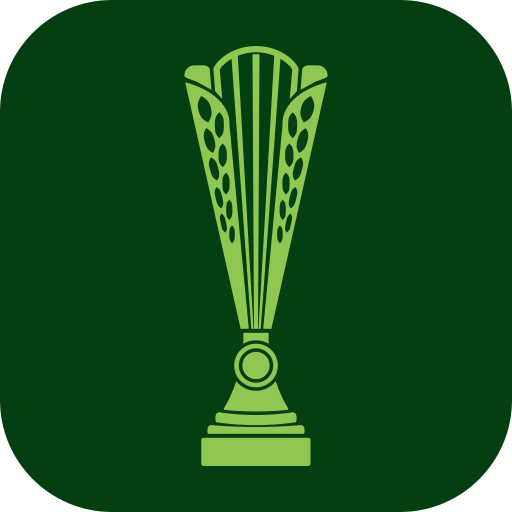

<div align="center">



# Frankfurtleague

The software behind [frankfurtleague.de](https://frankfurtleague.de), the website of the Frankfurt
League, _die Oberstufenliga der Frankfurter Schulen_.

[](https://github.com/felzab/frankfurtleague/actions/workflows/verify.yml)
[](LICENSE)

[Website](https://frankfurtleague.de) · [About](https://frankfurtleague.de/about) ·
[Organisation](https://frankfurtleague.de/organisation) · [Contact](https://frankfurtleague.de/kontakt)

</div>

## About

The Frankfurt League is a football league for Frankfurt's schools. Each team is one school's
graduating year group (_Abi-Jahrgang_), and every match raises money for both teams' graduation
celebrations (_Abibälle_): its takings from tickets and sales on site are split between them after
the match, usually half each. The league is run by Frankfurt League e. V., an association of pupils
and volunteers.

This repository is the league's website: the public pages, and the tools the season is organised
with. The site is in German; the code and its documentation are in English.

## What it does

Anyone can follow the season: the fixtures and results (_Spielplan_), each group's table
(_Saisontabelle_), computed from the results, the knockout bracket (_Finalrunden_), every team and
its squad, and a search over the season's matches (_Spielsuche_).

The site also supports the season's organisation:

| Who                    | What the site lets them do                                                                  |
| ---------------------- | ------------------------------------------------------------------------------------------- |
| **Schools**            | Apply to play a season (_Bewerbung_), each contact person confirming by email               |
| **Contact people**     | Keep their team's squad list (_Kader_), and accept or decline the pupils who registered     |
| **Pupils**             | Register through their team's link (_Einladung_), and choose what is published about them   |
| **Referees**           | Confirm the details the league entered for them                                             |
| **Everyone signed in** | Manage passkeys, sign-ins and consents on one account page (_Konto_), or delete the account |
| **Administrators**     | Run the season, its draw and results, clubs, referees, venues, applications and access      |

Sign-ups open with the coming season.

A pupil's name appears on the public squad list only with their consent, and the surname only as an
initial. Unconfirmed applications and registrations expire, and a pupil's data is deleted once no
season the league keeps needs it. [`docs/datenschutz.md`](docs/datenschutz.md) has each decision and
the code behind it.

## How it is built

| Layer        | What                                                                                           |
| ------------ | ---------------------------------------------------------------------------------------------- |
| **Frontend** | Next.js (App Router, React Server Components), TypeScript, HeroUI, Tailwind CSS, Zod           |
| **Backend**  | FastAPI, Pydantic, PyMongo's async client                                                      |
| **Data**     | MongoDB: the league's database behind FastAPI, and a separate sign-in database                 |
| **Sign-in**  | Better Auth, with passkeys or emailed codes; administrators need a passkey                     |
| **Hosting**  | Docker Compose behind nginx on a single server; CI builds the images and the server pulls them |

Browsers never call the FastAPI backend: Next.js makes every read of league data on the server,
which is why caching lives in the frontend and the backend keeps no user sessions.
[`docs/frontend/overview.md`](docs/frontend/overview.md) explains how the two fit together.

## How changes land

Every change reaches `main` through a pull request. `./scripts/gate/verify.sh` runs every check,
from formatting to the database tests and both Docker images, and CI runs the same checks on every
pull request and every push to `main`;
[`docs/ops/spec.md`](docs/ops/spec.md#16-the-verification-gate) lists them.

## Documentation

Start with [`docs/README.md`](docs/README.md). The domain vocabulary is German (`Spiel`, `Spieltag`,
`Saison`, `Kader`), and [the glossary](docs/glossary.md) explains each term. Some choices that look
like mistakes are deliberate: each is listed in [`docs/decisions.md`](docs/decisions.md).

```text
fl_frontend/     Next.js app: routes under src/app/, feature slices under src/features/
fl_backend/      FastAPI app: one package per slice under app/api/
nginx/           reverse proxy configuration, local and production
scripts/         the checks, and the deploy and operations scripts
docs/            the documentation
.github/         CI workflows and the issue forms
.claude/         instructions and rules for the AI coding agents
```

## Who builds it

Frankfurtleague, the software in this repository, is designed, developed and maintained by one
person: me, [@felzab](https://github.com/felzab). I'm also a member of Frankfurt League e. V. I
work with AI coding agents, using Anthropic's [Claude Code](https://claude.com/product/claude-code):
they write and audit much of the code under my direction, and I decide what gets built, review the
work and merge every change.

## Feedback

Found a bug, or have an idea for the site? I'd be glad to hear about it through the
[issue forms](https://github.com/felzab/frankfurtleague/issues/new/choose). I work on this alongside
other things, so a reply can take a few days. I'm not looking for pull requests for now. Questions
about the league itself are best sent through [the contact page](https://frankfurtleague.de/kontakt).

## Security

Please don't report a suspected vulnerability in a public issue. [`SECURITY.md`](SECURITY.md) explains
how to report it privately and what is in scope.

## License

I hold the copyright in the code and publish it under the Elastic License 2.0 (`Elastic-2.0`). That
makes it source-available, not open source: you may use, copy, change and share it, but not offer it
to others as a hosted or managed service. [`LICENSE`](LICENSE) has the full terms.

The league's name and logo belong to Frankfurt League e. V. and, like the league's data, are not
licensed at all ([`NOTICE`](NOTICE) lists them). To ask about using any of it, get in touch through
[frankfurtleague.de/kontakt](https://frankfurtleague.de/kontakt).
