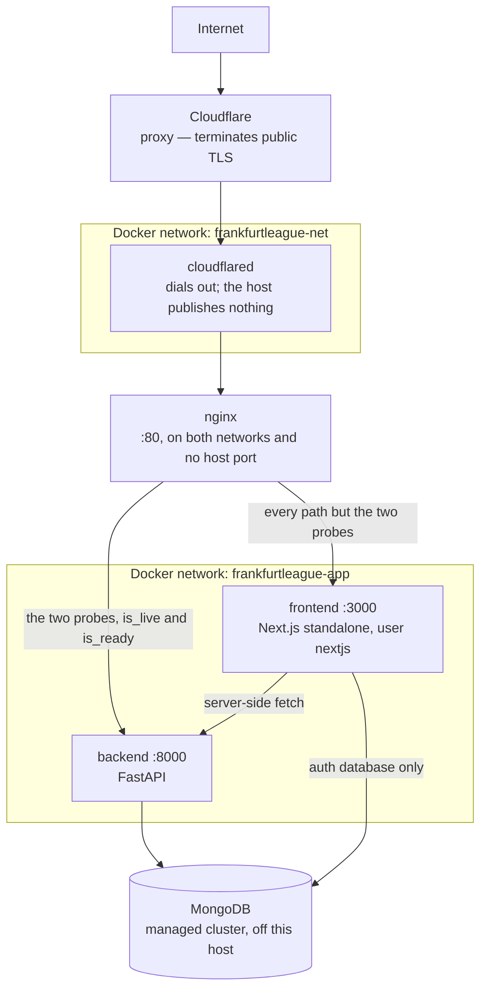

# Ops — overview

**Scope:** `docker-compose*.yml`, `nginx/`, `scripts/`, both Dockerfiles

Four containers on one host, reached through a tunnel connector rather than a published port and
deployed by pulling the images CI published. There is no orchestrator and no build on the server —
deliberately, because a server that builds is a server that can fail a build.

## How it is organised

**The diagram is production's** — the local stack adds its own database service to the application
network and points both application services at it ([`spec.md`](spec.md) §1.5). **nginx alone
joins both networks**, so the connector reaches nothing else.

**The host publishes no port at all**: the connector dials out, so nginx's
routing table is the whole of what the internet can address on this host, and there is no address to
reach it at otherwise.

**The two arrows into the cluster are two different database users**, neither holding a
`*AnyDatabase` role: the backend on the application database alone, the sign-in library on `auth`
alone. No file here records either grant — the backend's was read from the cluster's users
2026-08-02, and the sign-in store's is made by hand in the Atlas console. **Never give the two a
shared login** — that makes the boundary a matter of trust rather than of configuration. The backend's
user needs `readWrite` and nothing beyond it: the boot builds indexes, an action `readWrite` carries.

## The Cloudflare proxy

Nothing here manages the Cloudflare account, its DNS or its SSL mode, and none of what follows is
visible from a configuration file in this repository.

- **A visitor's TLS session terminates at Cloudflare.** The connector hands each request to nginx
  as plain HTTP over the stack's own network, so nginx holds no certificate, and an origin failure
  can surface as a Cloudflare error code ([`spec.md`](spec.md) §1.8).
- **The headers a visitor receives are whatever survives the proxy**, so they are a property to
  re-verify against `nginx/shared/security_headers.conf` rather than assume.
- **Cloudflare compresses only what arrives uncompressed**, and its own compression measured _worse_
  than the origin's on the same file (2026-08-01), so the origin keeps compressing and brotli is never
  precompressed at build time (`docs/decisions.md`).
- **The AI-crawler opt-out is an enforcement in one edge setting, and a request as well once a
  second is switched on.** Cloudflare's AI-bot controls block the AI-training crawlers. Once its
  managed `robots.txt` is switched on, it puts their list before the rules
  `fl_frontend/src/app/robots.ts` writes, which each crawler chooses whether to obey; while it is off,
  nothing asks them ([`spec.md`](spec.md#18-the-edges-declared-state) records whether each is on).
  **The failure to watch for is a link preview that
  silently stops rendering**, because previews are fetched by `facebookexternalhit`, an agent
  neither setting is aimed at: consolidation moving preview fetching behind one they name would break every
  WhatsApp and Facebook preview with nothing here to explain it. `curl -A` against the live site,
  one agent at a time, separates an edge block from a markup problem.

**Edge settings deliberately off**, each looking like free performance:

- **Rocket Loader** reorders script execution, which React hydration and Next's streaming depend on.
- **Cloudflare Fonts** removes third-party font requests, and `next/font` self-hosts at build time, so
  there are none.
- **Shared Dictionary Compression** deltas a file against an older version of itself, and every chunk
  here is content-hashed, so a rebuild produces a new filename instead.

**Early Hints** is the one worth turning on — the HTML already emits a `Link: rel=preload` header
Cloudflare can promote to a 103. What is actually set is readable only in the Cloudflare dashboard.

## Routing

A backend route is unreachable from the internet unless an nginx location publishes it; **a frontend route runs the other way round** — the catch-all carries every
path nginx does not name to Next, so a route handler is reachable the moment it exists, and its own
authorization is all that stands in front of it.

The API's documentation is the committed `fl_backend/openapi.json`: `fl_backend/app/main.py` builds
the app with FastAPI's `openapi_url=None`, so the running app serves neither the document nor its
`/docs` and `/redoc` pages.

## Security posture

**The origin is hardened even though a proxy sits above it**: the header set at
[`spec.md`](spec.md) §1.4, and a default server answering an unknown `Host` with `421`.

**The published unauthenticated writes are rate-limited at the edge**, and so is every page a mailed
or shared link opens. A server action, the sign-in's among them, whose id ships in a client chunk, is
metered at whatever path it is posted to. Which location carries which zone, and what carries none,
is [`spec.md`](spec.md) §1.3.

## Images and deployment

**The builder stage has no reachable backend and no real environment**:
anything reaching the API or constructing a URL from `AUTH_URL` at module scope fails the image build
rather than at runtime.

A deploy pulls the build's images, lets Compose recreate each service whose image or definition
moved, and reloads nginx, which keeps serving across the swap. What each ending leaves running, and
how to go back to an earlier build, are [`runbooks.md`](runbooks.md) §1.

## Read next

- [`spec.md`](spec.md) — the service contracts and the invariants
- [`runbooks.md`](runbooks.md) — the recurring procedures, and what this repository cannot record about the host
- [`../frontend/overview.md`](../frontend/overview.md) — the application server behind nginx
- [`../backend/overview.md`](../backend/overview.md) — the API it fetches from
